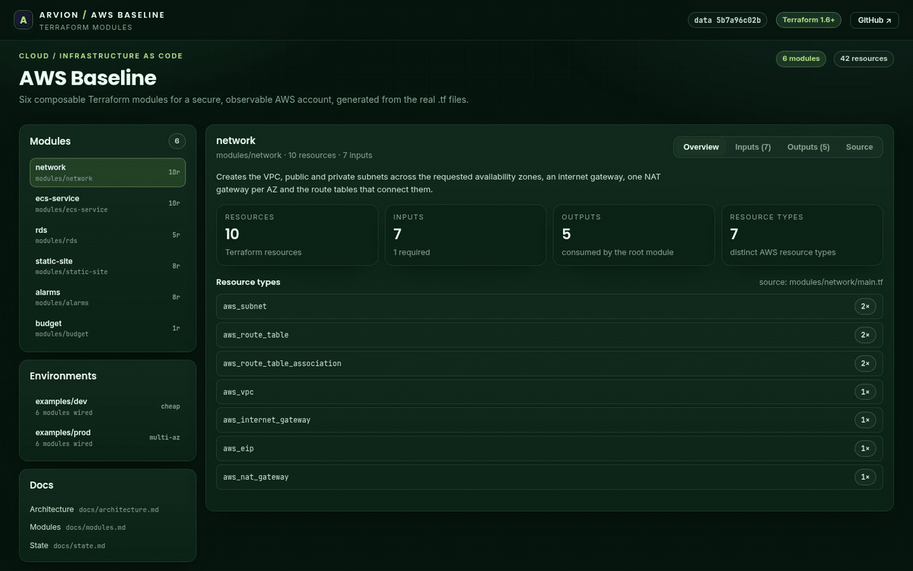
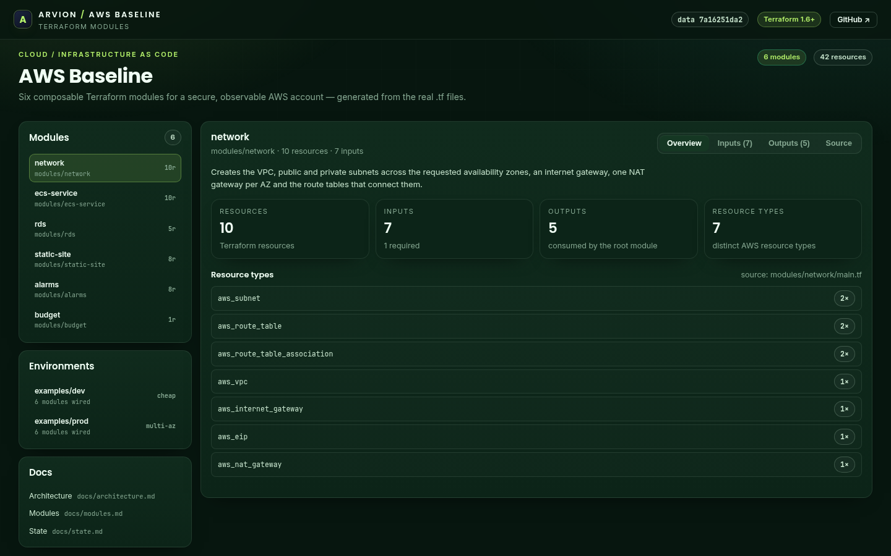
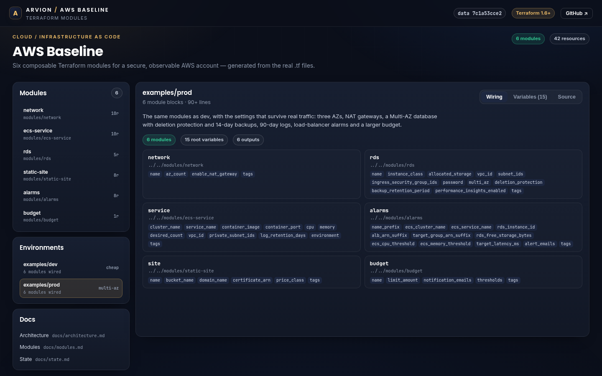

<div align="center">

</div>

<sub>Recorded from the live demo — <a href="docs/demo.mp4">MP4</a> · <a href="docs/screenshot.png">static frame</a></sub>

# AWS Baseline

Six composable Terraform modules for a secure, observable AWS account: a VPC
with private workloads, an ECS Fargate service, a private PostgreSQL database, a
private S3 + CloudFront site, CloudWatch alarms and a monthly budget. Two
environment examples wire them together, and a browser explorer renders the real
inputs and outputs from the `.tf` files.

[**Open the live demo**](https://arvion-technology.github.io/labs/demos/aws-baseline/) · [MIT](LICENSE)

---

This is the shape of account we set up before a first deploy: no public
databases, no public buckets, no wildcard IAM, encryption at rest on by default,
alarms that reach a topic, and a budget that warns before the invoice does. It
is intentionally small enough to read in one sitting, and every module can be
taken on its own.

## What it does

- **`network`** — VPC, public/private subnets across 2-3 AZs, one NAT gateway per
  AZ, route tables and associations.
- **`ecs-service`** — Fargate service and task definition, log group, separate
  task/execution IAM roles, Secrets Manager access limited to the ARNs passed in,
  and a task security group with egress only.
- **`rds`** — PostgreSQL in private subnets, encrypted storage, forced SSL,
  Performance Insights, backups, optional Multi-AZ and deletion protection.
  `publicly_accessible` is hard-coded to false.
- **`static-site`** — private S3 bucket with all four public access blocks, a
  CloudFront distribution using Origin Access Control, and a bucket policy that
  only allows this distribution to read.
- **`alarms`** — ECS CPU/memory alarms always; RDS and load-balancer alarms only
  when their identifiers are supplied.
- **`budget`** — monthly AWS Budget with forecasted-spend notifications.
- **Validation** — `node scripts/validate.mjs` runs structural checks always and
  `terraform fmt -check` / `terraform validate` when a Terraform binary exists.

## Screenshots

| Module explorer | Environment wiring |
| --- | --- |
|  |  |

## Architecture

```text
internet ──► ALB (caller) ──► ECS Fargate service ──► RDS (private)
                                   │
                                   ├── CloudWatch alarms ──► SNS
                                   └── logs

S3 bucket (private) ──► CloudFront (OAC) ──► visitor

VPC: public subnets (ALB, NAT) + private subnets (tasks, database)
```

Full diagram and trade-offs: [`docs/architecture.md`](docs/architecture.md).
Module inputs/outputs: [`docs/modules.md`](docs/modules.md). State layout:
[`docs/state.md`](docs/state.md).

The demo presents the same information interactively. `scripts/build-data.mjs`
parses the real modules with `src/hcl.js` and writes `demo/data.js`; a test
recomputes the hash, so the explorer cannot show inputs that no longer exist.

## Quickstart

```bash
git clone https://github.com/arvion-technology/aws-baseline.git
cd aws-baseline
npm test               # 23 tests, no dependencies
npm run validate       # structural checks, plus terraform fmt/validate if installed

cd examples/dev
terraform init
export TF_VAR_db_password="$(openssl rand -hex 24)"
terraform plan
```

A minimal module call:

```hcl
module "rds" {
  source = "../../modules/rds"

  name                       = "checkout-db"
  vpc_id                     = module.network.vpc_id
  subnet_ids                 = module.network.private_subnet_ids
  ingress_security_group_ids = [module.service.service_security_group_id]
  password                   = var.db_password
  multi_az                   = true
}
```

The validation script is the local gate:

```bash
node scripts/validate.mjs
# Terraform baseline — 6 modules, 2 examples
# terraform: not installed — fmt/validate skipped; structural checks below still apply
#
# checked 48 files: 6 modules, 69 variables, 28 outputs, 42 resources, 2 examples
# structural checks passed
```

## How it works

**Structural validation is independent of Terraform.** `src/validate.js` parses
each file with `src/hcl.js`, checks brace balance, requires descriptions on every
variable and output, compares declared variables with `var.*` usages (including
inside string interpolations), verifies example module sources exist, and scans
for hardcoded passwords and public resource settings. These checks run without
Terraform installed, which is why `npm test` works on any machine. The
`terraform fmt` and `validate` steps are additive: the script detects the binary
and, when present, also runs `init -backend=false` per example. CI installs
Terraform 1.9.8 and runs both layers.

**The database is private without a toggle.** `publicly_accessible` is not a
variable; the module sets it to `false` in code, and the structural validator
fails if that line changes. Ingress is only from the security groups the caller
passes. A baseline with a "just for debugging" public database switch is a
baseline that eventually ships with it on.

**IAM is split by purpose.** The ECS execution role can read exactly the
Secrets Manager ARNs listed in `secrets`, and the task role starts with
permission to write its own log stream. Neither has `Resource: "*"`; the
validator rejects a wildcard resource in that module. The app-specific
permissions are meant to be attached by the calling configuration, where they
are reviewable next to the service they belong to.

**Optional infrastructure uses `count`, not nullable arguments.** A CloudWatch
alarm with a null dimension is invalid and a load balancer is not part of every
account. The alarms module counts RDS alarms to zero when no instance id is
given, and ALB alarms to zero without both ARN suffixes. The dev example
therefore produces no broken alarms instead of failing at plan time.

## Tests

```bash
npm test
```

23 `node:test` cases across three files. `hcl.test.js` covers the block scanner
(strings with braces, heredocs, interpolated `var.*`, syntax balance);
`validate.test.js` proves the repository passes and then mutates copies to
confirm each rule fires (public database, missing description, undeclared
variable, bad module source, committed secret, whitespace, broken CI wiring,
missing README); `data.test.js` checks that the generated explorer data matches
the files and that `scripts/validate.mjs` exits zero.

```bash
node scripts/validate.mjs    # structural checks + terraform if available
node scripts/build-data.mjs  # regenerate demo/data.js after editing modules
```

## Limitations

There is no load balancer, autoscaling policy, Route 53 zone, ACM validation,
WAF, VPC endpoint or Secrets Manager rotation in this repository. The ALB is the
main omission: the service exposes its security group so a caller can attach it
to an existing target group, but a complete web stack still needs that piece.
The examples do not create the remote state bucket; `docs/state.md` documents
the layout because a state bucket shared by an example is a state bucket two
teams will trample. The database password ends up in Terraform state even though
it is marked sensitive, which is why the state bucket must be private and
encrypted. Terraform itself was not installed in the environment where this was
built, so `terraform validate` has not been executed here; the structural
validator and CI cover what can be checked without it, and the first CI run is
the real Terraform check.

## Project layout

```text
aws-baseline/
├── modules/
│   ├── network/          # VPC, subnets, NAT, routes
│   ├── ecs-service/      # Fargate service, IAM, logs, security group
│   ├── rds/              # private PostgreSQL, backups, SSL
│   ├── static-site/      # S3 + CloudFront + OAC
│   ├── alarms/           # SNS + CloudWatch alarms
│   └── budget/           # AWS Budgets notifications
├── examples/
│   ├── dev/              # cheap two-AZ stack
│   └── prod/             # three-AZ stack with Multi-AZ database
├── docs/                 # architecture, module reference, state
├── src/                  # HCL reader + structural validator
├── scripts/              # validate.mjs, build-data.mjs
├── test/                 # 23 node:test cases
└── demo/                 # static explorer generated from the real files
```

## Credits

Built by [Arvion Technologies](https://arviontech.net) in Kathmandu as part of
our open-source [Labs](https://github.com/arvion-technology/labs) series. MIT
licensed.
